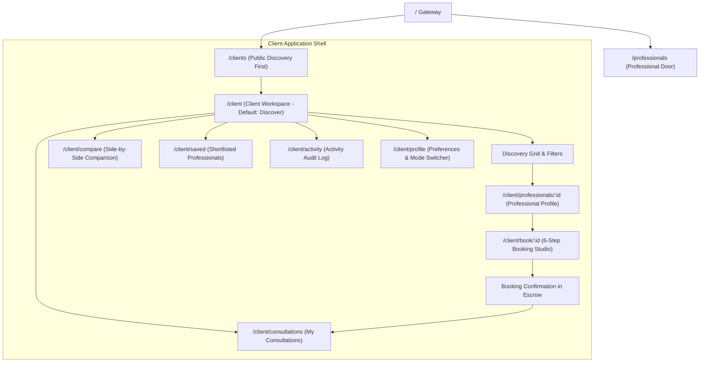

# Vastoco — Client Information Architecture (V2)
**Project:** Vastoco Design Hackathon 2026  
**Product Area:** Client Discovery & Authenticated Workspace  
**Design Principle:** Discovery First · Zero Marketing Barriers · Verified Trust  
**UI Palette:** Strict Espresso `#3C2415` & Pale Oak `#DDD9CE`  

---

## 1. Executive Summary

Vastoco Client Experience V2 restructures the client journey from a passive marketing landing page into an information-dense, **Discovery-First** application. Homeowners planning residential projects across Delhi NCR immediately access real-looking professional listings, transparent upfront consultation rates, verified credential badges, and calculated client ratings above the fold.

Both the public entry point (`/clients`) and the authenticated workspace (`/client`) share the same underlying data model, discovery engine, and card components.

---

## 2. Global Site Map & Routing Architecture

---

## 3. Route Inventory & Responsibilities

| Route | Page Name | Primary Objective | Key Features & Invariants |
| :--- | :--- | :--- | :--- |
| `/clients` | Public Discovery | Immediate professional discovery for first-time visitors | Large search, category chips, service pills, filter sidebar, professional cards, upfront fees, comparison tray dock. Zero marketing walls. |
| `/client` | Authenticated Workspace | Daily client hub with personalized project context | Personalized greeting, next upcoming consultation card, saved professionals shelf, recent activity feed, followed by unified discovery grid. |
| `/client/compare` | Comparison Studio | Side-by-side evaluation of up to 2 professionals | 2-column matrix (desktop) or stacked paired attributes (mobile): credentials, experience, portfolio, ratings, and 15/30/45m fees. |
| `/client/saved` | Saved Shortlist | Management of bookmarked architects and designers | Quick unsave, compare checkbox, direct booking access, empty state with discovery fallback. |
| `/client/consultations`| Consultations Hub | Lifecycle management of video consultations | Three tabs: Upcoming, Completed, Cancelled. Displays booking reference, 85% pro share, 15% platform fee, 100% escrow status. |
| `/client/activity` | Activity Timeline | Chronological audit trail of user actions | Events for saves, comparisons, bookings, completions, and review submissions with direct navigation links. |
| `/client/profile` | Preferences & Settings| Project scope preferences and evaluation mode | Client identity, default Delhi NCR locality, and interactive mode switcher (`Active Client`, `New Client`, `Returning Client`). |
| `/client/professionals/:id` | Professional Monograph | Comprehensive evaluation of a single professional | Verified registration check, calculated rating summary with 5-to-1 star distribution, genuine portfolio with empty toggle, upfront fees, reviews list. |
| `/client/book/:id` | Consultation Booking | 6-step simulated consultation reservation | Duration selection (15/30/45m), date/time slots (with unavailable slot alert), budget/scope inputs, fee summary, simulated payment with failure toggle, confirmation. |

---

## 4. Navigation Architecture

### 4.1 Desktop Navigation Shell (`>768px`)
* **Brand Header**: Vastoco logo linked to `/client` with a distinct `Client Workspace` badge.
* **Top Navigation Links**:
  1. `Discover` (`/client`) — Active indicator underline.
  2. `Compare` (`/client/compare`) — Dynamic pill badge displaying count of selected items (e.g. `2`).
  3. `Saved` (`/client/saved`) — Dynamic pill badge displaying count of saved items (e.g. `2`).
  4. `My Consultations` (`/client/consultations`) — Direct booking manager access.
  5. `Activity` (`/client/activity`) — Audit timeline.
  6. `My Profile` (`/client/profile`) — Client preferences.
* **Right Controls**:
  - Interactive **Mode Switcher** dropdown allowing evaluators to switch between `Active Client`, `New Client`, and `Returning Client` states with one click.
  - `Public View` button to return to the public marketing entry point (`/clients`).

### 4.2 Mobile Bottom Navigation (`≤768px`)
* Fixed 56px bottom navigation bar with safe-area inset:
  1. **Explore** (`/client`): Search icon.
  2. **Compare** (`/client/compare`): Compare icon with dynamic badge.
  3. **Saved** (`/client/saved`): Bookmark icon with dynamic badge.
  4. **Bookings** (`/client/consultations`): Calendar icon.
  5. **Profile** (`/client/profile`): User icon.
* *Invariant:* Bottom navigation is strictly isolated to `/client/*` application routes and is **never** rendered on public marketing pages (`/`).
* Page containers automatically inject `padding-bottom: 72px` to guarantee zero content clipping.

---

## 5. Information Density & Visual Hierarchy

1. **Above-the-Fold Prioritization**:
   - Eyebrow location tag (`Delhi NCR · Architecture · Interiors · Vastu`).
   - Clear editorial Didone headline: *"Find the right professional for your project."*
   - Unified search bar with embedded locality selector.
   - Discipline category chips (`Architects`, `Interior Designers`, `Vastu Consultants`).
   - Service discovery pills (`Architecture`, `Interior design`, `Home renovation and space planning`, `Vastu consultation`).
   - Live results counter (`Showing 6 verified professionals in Delhi NCR`).
2. **Professional Decision Cards**:
   - Large authentic portfolio photographs with verification badges.
   - Direct overall rating badge (`4.8 ★ (36)` or `New to Vastoco`).
   - Years in practice and core specializations.
   - Upfront consultation fees for 30m bolded, with 15m and 45m options visible.
   - High-contrast actions: Save bookmark, Compare checkbox, View profile, and Book consultation.
3. **Escrow & Trust Foundation**:
   - 100% escrow protection prominently displayed on all cards, profile monograph, fee breakdowns, and booking summaries.
   - 85% professional earnings transparency clearly explained on every consultation record.

