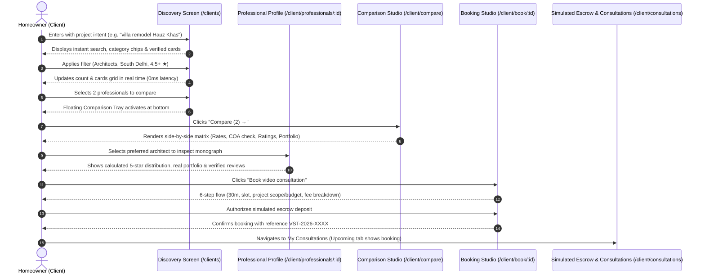

# Vastoco — Client UX Flow Specification (V2)
**Project:** Vastoco Design Hackathon 2026  
**UX Paradigm:** Discover → Search → Filter → Evaluate → Compare → Book → Consult  
**Mode:** Ponytail FULL Mode  
**Brand Palette:** Strict Espresso `#3C2415` & Pale Oak `#DDD9CE`  

---

## 1. End-to-End Client Journey Overview

---

## 2. Step-by-Step Flow Specifications

### 2.1 Discovery & Real-Time Search Flow
1. **Initial Viewport**: Homeowner arrives at `/clients`. Listings are immediately visible without scrolling through marketing copy.
2. **Text Search**: Client types keyword (e.g. `villa`, `courtyard`, `Naina`, `Hauz Khas`). Input is debounced at 150ms and filters across names, professions, specializations, biographies, and project titles. Clear `✕` button restores default view.
3. **Locality Selection**: Embedded dropdown selects Delhi NCR sub-regions (`South Delhi`, `Gurgaon`, `Noida`, `Central Delhi`, `West Delhi`).
4. **Discipline Category Filter**: Clicking `Architects`, `Interior Designers`, or `Vastu Consultants` instantly isolates professionals matching that role.
5. **Service Discovery Pills**: Clicking `Architecture`, `Interior design`, `Home renovation and space planning`, or `Vastu consultation` refines listings by project typology.

### 2.2 Functional Filter & Rating Refinement Flow
1. **Sidebar / Mobile Drawer**: Homeowner adjusts filters:
   - *Client Rating*: Any, 4.5+ ★, 4.0+ ★, and checkbox toggle *“Include new professionals with no reviews”*.
   - *Experience*: Any, 5+ yrs, 8+ yrs, 10+ yrs.
   - *Max 30m Fee*: Up to ₹1,300, ₹1,500, ₹2,000, or Any.
2. **Active Filter Chips**: Applied filters appear as removable chips in a toolbar above the grid. Clicking `✕` on any chip immediately relaxes that filter.
3. **Sorting**:
   - `Most relevant` (default curated architectural diversity).
   - `Highest rated` (primary key: calculated average rating; secondary key: eligible review count).
   - `Most reviewed` (descending by published review count).
   - `Most experienced` (descending by years in practice).
   - `Consultation fee: low to high` / `high to low`.
4. **Empty State Recovery**: If filters produce zero results, an illustrated empty state appears (`empty-search.svg`) explaining that no records match the combination, offering a one-click *“Clear all filters”* action.

### 2.3 Side-by-Side Comparison Flow (Maximum 2 Professionals)
1. **Selection**: Homeowner checks the `Compare` checkbox on any card.
2. **Comparison Tray Dock**:
   - **0 selected**: Dock is completely hidden.
   - **1 selected**: Dock slides up from bottom displaying Professional 1 thumbnail, name, profession, and empty slot placeholder for Professional 2.
   - **2 selected**: Both slots filled. Primary action button *“Compare (2) →”* enables with active Espresso fill.
   - **3rd selected attempt**: System prevents checkbox toggle and triggers an accessible toast alert: *“You can compare a maximum of 2 professionals. Remove one from your comparison tray to add another.”*
3. **Comparison Screen (`/client/compare`)**:
   - Desktop: Side-by-side 2-column matrix with aligned attribute rows.
   - Mobile: Stacked paired attribute blocks to prevent horizontal table scrolling.
   - Attributes compared: Full identity, COA / verification registration, calculated average rating & review count, years of practice, specializations, upfront fees for 15m/30m/45m, and recent portfolio thumbnails.
   - Actions: *“Book consultation”*, *“Remove from comparison”*, and *“Clear all”*.

### 2.4 Decision-Focused Monograph & Reviews Flow (`/client/professionals/:id`)
1. **Monograph Stage**:
   - Left: Authentic architectural photo with `COA Active Register Check` badge.
   - Right: Identity, profession, location, bio, experience, and direct actions (`Book consultation`, `Save`, `Compare`).
2. **Credential Verification Proof**: Council of Architecture registration number (`CA/2016/78210`) with explanation of statutory gazette verification.
3. **Rating & Review Summary Component**:
   - Calculated average score (e.g. `4.8` out of 5).
   - Total eligible reviews count (`36 published reviews`).
   - Five horizontal distribution bars (5★ through 1★) with exact counts and percentages in Pale Oak and Espresso.
   - Verified review integrity callout explaining that reviews can only be submitted by verified clients who completed a consultation.
4. **Project Portfolio Gallery**:
   - High-resolution photographs with dimensions, locations, and photographer attributions.
   - Interactive *“Simulate empty portfolio toggle”* button to demonstrate edge-case testing without breaking production state.
5. **Interactive Reviews Feed**:
   - Star filter buttons (`All`, `5★`, `4★`, `3★`, `2★`, `1★`) dynamically filter cards.
   - Sorting by `Most relevant`, `Newest`, `Highest rating`, `Lowest rating`.
   - Each review displays client initials avatar, display name, date, consultation context badge, and a functional *“Report”* moderation button.

### 2.5 6-Step Consultation Booking Flow (`/client/book/:id`)
1. **Step 1 — Duration Selection**: Radio cards for 15 Mins, 30 Mins, and 45 Mins. Changing duration immediately updates the right-hand fee summary card and button total.
2. **Step 2 — Available Slot Selection**: Slot buttons display available dates and times. Selecting the slot marked `Unavailable` displays an inline error alert: *“This consultation slot is no longer available. Please select another time or date above.”*
3. **Step 3 — Project Scope & Budget**: Dropdowns for estimated project budget (`₹20L – ₹50L`, etc.), target timeline (`1 – 3 Months`), and textarea for project questions.
4. **Step 4 — Fee Breakdown & Escrow Summary**:
   - Professional Share: 85% of total fee.
   - Vastoco Platform Fee: 15% of total fee (deducted from fee, zero hidden charges).
   - Total Upfront Escrow Deposit.
5. **Step 5 — Simulated Payment & Failure Toggle**:
   - Checkbox *“Simulate payment gateway failure”* allows testers to simulate card/UPI rejection with an inline error banner.
   - When unchecked, clicking *“Confirm & Pay”* simulates payment authorization and creates an active booking record in session storage.
6. **Step 6 — Booking Confirmation Dialog**:
   - Generates unique reference code (`VST-2026-XXXX`).
   - Displays booked duration and escrow status.
   - Primary button navigates directly to `My Consultations`.

### 2.6 Authenticated Workspace & State Switching Flow
1. **Workspace Hub (`/client`)**:
   - Upcoming consultation card with pro photo, date, time, and *“Join video call (demo simulation)”* button.
   - Recently saved professionals shelf with direct booking and compare access.
   - Recent activity feed showing timestamps and deep links.
2. **Interactive State Switcher**:
   - Evaluators can toggle between `Active Client`, `New Client`, and `Returning Client` using the header dropdown or the profile settings buttons.
   - `New Client` mode immediately demonstrates the clean empty-state onboarding experience.

