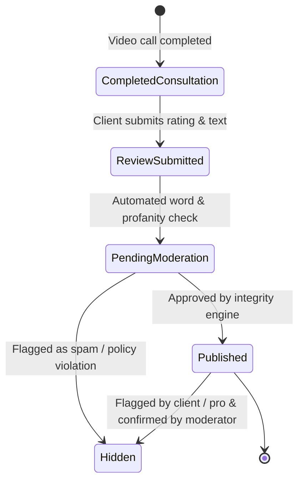

# Vastoco — Rating & Review Integrity Rules (V2)
**Project:** Vastoco Design Hackathon 2026  
**Policy Name:** Verified Review Integrity Standard  
**Integrity Rule:** Zero Fake Reviews · Only Completed Consultations May Review  
**Palette:** Strict Espresso `#3C2415` & Pale Oak `#DDD9CE`  

---

## 1. Core Review Eligibility Policy

1. **Prerequisite Consultation Completion**:
   - A client is only eligible to submit a review after an official video consultation session has taken place and been marked as `completed` within the Vastoco platform.
   - General visitors, unverified accounts, and clients with cancelled or pending appointments cannot submit reviews.
2. **One Review per Completed Session**:
   - Each completed consultation grants exactly one review token tied to that specific `consultationId`.
   - Duplicate reviews for the same consultation record are strictly blocked at the data validation boundary.
3. **No Purchased, Imported, or Fabricated Testimonials**:
   - Vastoco enforces a strict zero-fake-review policy.
   - External testimonials from Google, Facebook, or personal websites cannot be imported.
4. **Separation of Verification and Ratings**:
   - Credential verification (Council of Architecture gazette check for architects, identity/portfolio audit for interior designers, certification review for Vastu) is independent of client ratings.
   - A high rating is never accepted as proof of statutory qualification.

---

## 2. Review Lifecycle & Status Pipeline

### Publication States:
* `status: 'published'`: Fully approved review record. Included in average rating calculation, review count, and star distribution bars.
* `status: 'pending'`: Awaiting moderation check. **Excluded from public averages and counts.**
* `status: 'hidden'`: Moderated or flagged violation record. **Excluded from public averages and counts.**

---

## 3. Mathematical Rating Calculation Engine

### 3.1 Mathematical Formula
For a given professional $P$ with eligible published reviews $R_{\text{published}} = \{r_1, r_2, \dots, r_n\}$:

$$\text{Review Count } (N) = |R_{\text{published}}|$$

$$\text{Raw Average } (\bar{R}) = \frac{1}{N} \sum_{i=1}^{N} r_i.\text{rating}$$

$$\text{Displayed Average} = \text{round}(\bar{R}, 1)$$

### 3.2 Sample Verification (Naina Kapoor)
* Published reviews: 36
* 5-Star reviews: 31 ($31 \times 5 = 155$)
* 4-Star reviews: 3 ($3 \times 4 = 12$)
* 3-Star reviews: 1 ($1 \times 3 = 3$)
* 2-Star reviews: 1 ($1 \times 2 = 2$)
* 1-Star reviews: 0 ($0 \times 1 = 0$)
* **Total Score Sum**: $155 + 12 + 3 + 2 = 172$
* **Calculated Average**: $\frac{172}{36} = 4.7777\dots$
* **Formatted Display**: **`4.8`**
* **Distribution Percentages**:
  - 5★: $31 / 36 \approx 86\%$
  - 4★: $3 / 36 \approx 8\%$
  - 3★: $1 / 36 \approx 3\%$
  - 2★: $1 / 36 \approx 3\%$
  - 1★: $0 / 36 = 0\%$

### 3.3 Zero-Review Handling (Empty State)
* If $N = 0$:
  - Average rating is `null`.
  - Display badge: **`New to Vastoco`** or **`No reviews yet`**.
  - **Forbidden**: Displaying `0.0` or empty star outlines that resemble zero feedback.
  - Display message: *"Reviews can only be submitted by verified clients who have completed a video consultation."*

---

## 4. Sorting & Ranking Invariants

1. **Highest-Rated Sort (`rating_desc`)**:
   - **Primary Key**: Calculated average rating descending ($4.8 > 4.6 > 4.5$).
   - **Secondary Key**: Eligible review count descending.
   - *Example:* Naina Kapoor (`4.8` from 36 reviews) ranks **above** Dev Malhotra (`4.8` from 12 reviews).
   - *Unrated Handling:* Professionals with zero reviews are placed at the end of the sorted list, but are **not** scored as `0.0`.
2. **Most-Reviewed Sort (`reviews_desc`)**:
   - Primary Key: Published eligible review count descending ($36 > 24 > 18 > 12 > 1 > 0$).
3. **Filtering by Rating Threshold**:
   - `4.5+ ★`: Matches only professionals with $\text{rating} \ge 4.5$.
   - `4.0+ ★`: Matches only professionals with $\text{rating} \ge 4.0$.
   - `Include professionals with no reviews` toggle:
     - When checked (default): Unrated professionals remain visible.
     - When unchecked: Unrated professionals are filtered out.

---

## 5. UI Presentation & Accessibility Standards

* **Star Glyphs**: Always rendered in pure **Espresso `#3C2415`**. Gold, yellow, orange, or amber stars are strictly disallowed under the hackathon brand constraints.
* **Readable Score & Count**: Every rating badge must present both the numeric score and the count:
  `4.8 ★ · 36 reviews`
  Never show an isolated star without the volume count.
* **Screen Reader Accessibility**:
  Every rating element carries an explicit accessible label:
  `aria-label="Rated 4.8 out of 5 from 36 reviews"`
* **Bar Chart Progressbars**:
  Each row in the 5-to-1 star distribution chart contains:
  `role="progressbar"` `aria-valuenow="86"` `aria-valuemin="0"` `aria-valuemax="100"` `aria-label="31 reviews with 5 stars"`

